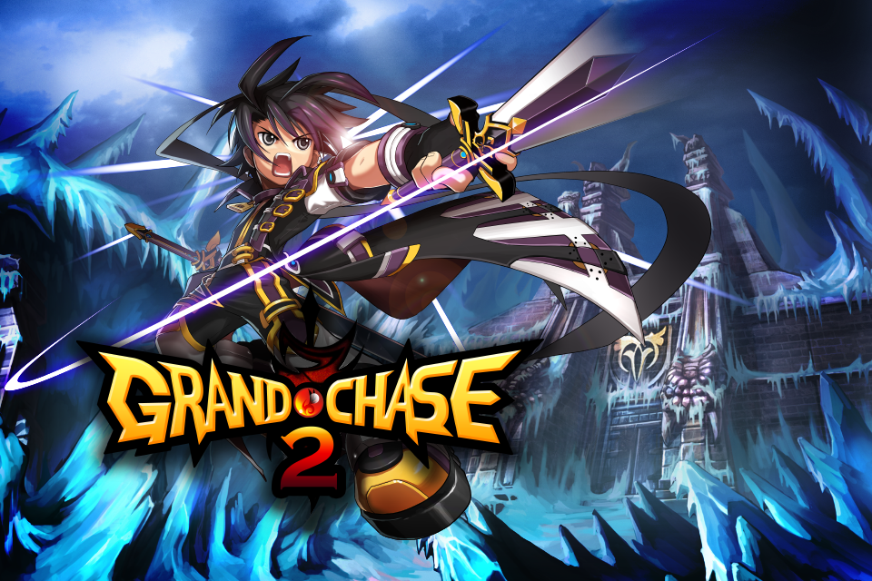
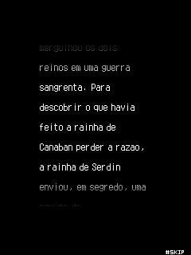
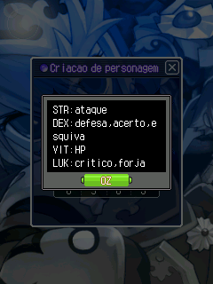
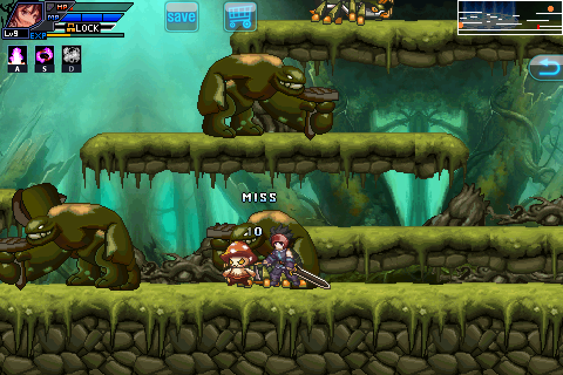
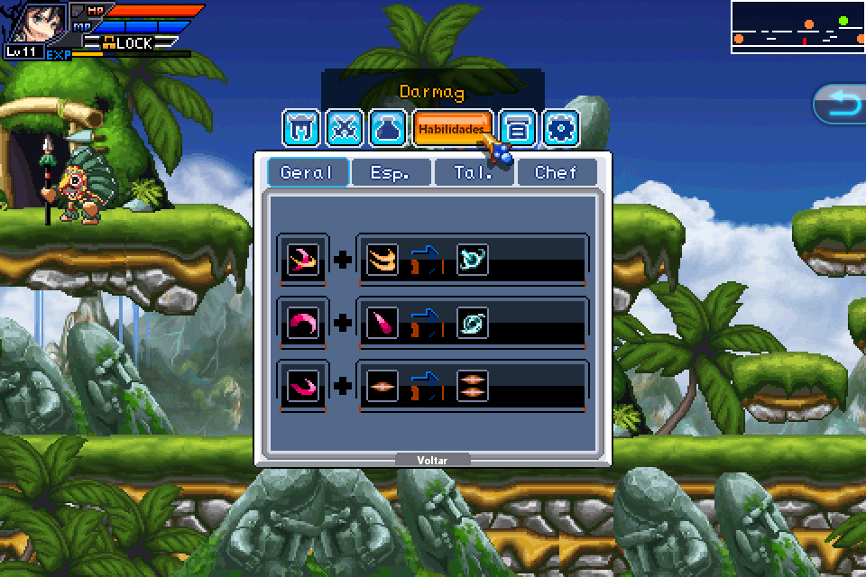
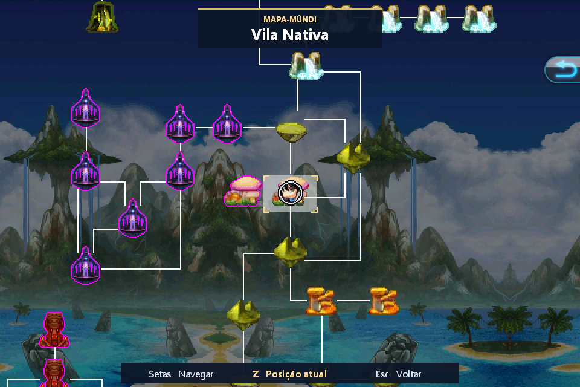
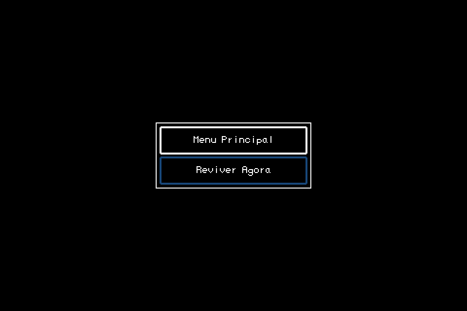

# Grand Chase Mobile — Coleção Definitiva para PC (GC1 & GC2)

<div align="center">



[](../../releases)
[]()
[-green.svg)]()
[]()
[]()

**A preservação definitiva das lendárias aventuras de celular de Grand Chase, reunidas e aprimoradas para computadores modernos com Windows.**

[Baixar Instalador Oficial (.EXE)](../../releases) • [Detonado GC1](#-detonados-e-guias-oficiais) • [Detonado GC2](#-detonados-e-guias-oficiais) • [Controles](#-tabela-completa-de-controles)

</div>

---

## 📌 Sobre o Projeto

**Grand Chase Mobile 1** e **Grand Chase Mobile 2** marcaram época nos celulares nos anos 2000 e início dos 2010. Com a evolução dos sistemas operacionais móveis, ambos os jogos corriam risco iminente de desaparecimento.

Este projeto realizou a **engenharia reversa, descompilação e porte nativo** completo de ambos os títulos para Windows de 64 bits. Os jogos não exigem emuladores pesados de celular: rodam diretamente pelo subsistema de alta performance em C++ e Rust, com aceleração de áudio e vídeo via **SDL 3**, traduções em português brasileiro, taxa de quadros suave, suporte total a gamepads modernos e jogabilidade 100% offline.

---

## ⚔️ Grand Chase Mobile 1 · A Jornada de Elesis

<div align="center">
  
  
</div>

Em **Grand Chase Mobile 1**, você assume o controle da destemida **Elesis Sieghart**, herdeira dos lendários Cavaleiros Vermelhos de Serdin. Quando seu pai, Elscud Sieghart, desaparece misteriosamente ao investigar os distúrbios em Canaban, Elesis parte em uma jornada épica pelo continente de Bermesiah.

- **Estilo RPG Clássico:** Explore vilas, castelos, masmorras e templos ancestrais, subindo de nível e aprimorando atributos de combate.
- **Forja e Transmutação de Ônix:** Colete materiais de monstros para combinar equipamentos, armas de cavalaria e sintetizar ônix mágicos com o alquimista Noah.
- **Encontros Históricos:** Presencie o cômico primeiro encontro entre **Elesis** e a maga **Arme** no Cais de Canaban, e descubra a triste possessão do jovem guerreiro **Lass** sob o domínio de **Cazeaje**.
- **Barra de Atalhos com 2 Páginas:** Gerencie poções e golpes especiais em 6 teclas rápidas (`A`, `S`, `D`, `F`, `G`, `H`), alternando entre duas páginas com a tecla `V` ou `L3` no controle.

<div align="center">
  
  
</div>

---

## 🗡️ Grand Chase Mobile 2 · A Saga de Sieghart

<div align="center">
  
  
</div>

Em **Grand Chase Mobile 2**, a fórmula evolui para um frenético **RPG de Ação e Plataforma Lateral 2D**. O protagonista é o lendário guerreiro imortal **Sieghart**, o mestre Highlander. Ao despertar em um mundo à beira do colapso dimensional, Sieghart precisa descobrir por que os antigos Deuses de Bermesiah foram corrompidos pelas trevas.

- **Combate Veloz e Fluido:** Encadeie sequências de espada no chão e no ar, esquivando-se de armadilhas e saltando entre plataformas.
- **Recuperação de MP por Ataques Físicos:** Nesta edição para PC, cada golpe de espada acertado nos inimigos restaura uma fração da sua energia mágica (MP), permitindo manter o ritmo de habilidades ativas sem depender apenas de poções.
- **IA de Inimigos com Perseguição Vertical:** Os monstros terrestres são inteligentes; agora eles pulam e escalam plataformas para perseguir Sieghart onde quer que ele esteja!
- **Pausa Tática Completa:** Pressionar `Esc` ou `Start` no controle congela instantaneamente todos os inimigos, projéteis e animações da tela.
- **Loja Cash 100% Offline:** Acesse a loja especial de itens a qualquer momento pelo menu ou mouse e obtenha todos os trajes raros, asas angelicais e armas com a moeda acumulada em jogo.
- **Mapa Conectado e Portais de Missão:** Navegue pelo mapa-múndi e destranque passagens secretas (como o lendário portal do Cânion do Silêncio para a Vila dos Anões).

<div align="center">
  
  
</div>

---

## 🎮 Tabela Completa de Controles

### Grand Chase Mobile 1 (Elesis)
| Comando | Teclado | Xbox / Compatível | PlayStation (PS4/PS5) |
|---|---|---|---|
| **Movimento** | Setas direcionais | Direcional / Analógico Esquerdo | D-Pad / Analógico Esquerdo |
| **Atacar / Interagir** | `Z`, `Espaço` ou `Enter` | Botão `A` | Botão `Cruz` (✕) |
| **Voltar / Menu** | `Esc` ou `Backspace` | Botão `B` / `Start` | Botão `Círculo` (○) / `Options` |
| **Atalhos 1 a 6** | `A`, `S`, `D`, `F`, `G`, `H` | `Y`, `LB`, `RB`, `LT`, `RT`, `R3` | `△`, `L1`, `R1`, `L2`, `R2`, `R3` |
| **Alternar Página de Atalhos** | `V` | `L3` (clique no analógico) | `L3` (clique no analógico) |
| **Mapa do Mundo** | `M` | Botão `Select` / `View` | `Share` / `Touchpad` |
| **Minimapa** | `Tab` | Analógico direito para baixo | Analógico direito para baixo |
| **Salvar Jogo** | `F5` (fora de combate) | Analógico direito para cima | Analógico direito para cima |

### Grand Chase Mobile 2 (Sieghart)
| Comando | Teclado | Xbox / Compatível | PlayStation (PS4/PS5) |
|---|---|---|---|
| **Mover / Agachar** | Setas `Esquerda`, `Direita`, `Baixo` | Direcional / Analógico Esquerdo | D-Pad / Analógico Esquerdo |
| **Pular** | `Seta Cima` | Botão `A` | Botão `Cruz` (✕) |
| **Atacar / Confirmar** | `Z` ou `Enter` | Botão `X` | Botão `Quadrado` (□) |
| **Especiais 1, 2 e 3** | `A`, `S` e `D` | `LB`, `RB`, `LT` | `L1`, `R1`, `L2` |
| **Poções Rápidas 1 e 2** | `1` e `2` | `R3` e `L3` | `R3` e `L3` |
| **Pausar / Voltar** | `Esc` | Botão `Start` / `Menu` | Botão `Options` |
| **Mapa do Mundo** | `M` | Botão `Select` / `View` | `Share` / `Touchpad` |
| **Salvar Jogo** | `W` (quando liberado) | Botão `Y` | Botão `Triângulo` (△) |
| **Remapeamento Livre** | Os controles podem ser totalmente personalizados pelo menu **Opções → Controles** no jogo. |

---

## 📥 Como Instalar e Jogar

1. Acesse a seção de **[Releases](../../releases)** deste repositório.
2. Baixe o instalador oficial: **`GrandChase-PC-Setup.exe`**.
3. Execute o instalador no seu Windows (10 ou 11 de 64 bits).
4. O assistente de instalação permite escolher o diretório e marcar a opção de **Criar Atalhos na Área de Trabalho** (com os ícones oficiais de Elesis e Sieghart).
5. Pronto! Basta abrir qualquer um dos jogos pelo atalho na Área de Trabalho ou pelo menu Iniciar.

---

## 💾 Onde Ficam os Saves?

Os saves e configurações do jogador são gravados automaticamente na pasta pessoal do usuário:
- **Grand Chase 1:** `C:\Usuários\<Seu_Usuario>\Documentos\Games\GrandChase1\PD138681`
- **Grand Chase 2:** `C:\Usuários\<Seu_Usuario>\Documentos\Games\GrandChase2`

> **Segurança:** O desinstalador oficial **nunca** apaga suas pastas de saves em Documentos. Seus heróis e conquistas estarão sempre protegidos!

---

## 📖 Detonados e Guias Oficiais

Junto com os jogos, a coleção inclui detonados passo a passo de todas as missões, chefes, segredos e rotas de entrega:
- 📕 **Detonado Completo de Grand Chase 1:** Arquivo `GrandChase1/CUIDADO.md` — cobre do Exame de Cavaleiro até o confronto final com Lass e Jin Cazeaje, além do Modo Difícil.
- 📘 **Detonado Completo de Grand Chase 2:** Arquivo `GrandChase2/CUIDADO.md` — guia passo a passo por todos os 7 capítulos, chefes divinos, culinária Highlander e a batalha contra a Escuridão Antiga.
- 🗺️ **Guia de Portais do Cânion (GC2):** Arquivo `GrandChase2/Mapa-e-portais.md` — explica detalhadamente as coordenadas e a missão necessária para liberar o portal da Vila dos Anões.

---

## ⚙️ Arquitetura Técnica e Engenharia Reversa

Este projeto foi possível através da união de diversas frentes de engenharia reversa e compilação de baixo nível:

```
+--------------------------------------------------------------+
|            Grand Chase Mobile PC Collection                  |
+------------------------------+-------------------------------+
|     Grand Chase 1 (Elesis)   |    Grand Chase 2 (Sieghart)   |
|   Runtime WIPI C/Java (WIE)  |   Re-host Nativo C++17        |
|   Recompilado em Rust nativo |   Emulador Unicorn CPU (ARM)  |
+------------------------------+-------------------------------+
|           Camada de Apresentação e Hardware (SDL 3)          |
|      Vídeo com VSync • Áudio OGG Vorbis • XInput/DInput      |
+--------------------------------------------------------------+
```

1. **WIPI Runtime (GC1):** O motor original em C coreano e formato executável móvel foi portado sobre a camada do projeto [wie](https://github.com/dlunch/wie), compilado com toolchain Rust de 64 bits sem dependência de JVM externa.
2. **Emulador Unicorn & Motor C++17 (GC2):** O binário nativo do Android (`libhello-jni.so`) foi mapeado e executado através de uma camada moderna em C++17 combinada com o motor de emulação Unicorn, interceptando chamadas gráficas para um framebuffer direto renderizado via SDL3.
3. **Correção de Estabilidade no Mapa-Múndi:** Corrigido o bug histórico que causava falha por estouro de memória (`0xc0000005`) durante o recorte de coordenadas do mapa ao navegar por nós distantes.
4. **Loja Cash Local:** O protocolo de requisição de compras da loja da operadora móvel foi redirecionado para um gerenciador interno offline, permitindo liberar itens sem transações de rede.

---

## ⚖️ Créditos e Reconhecimentos

- **WIE Runtime:** Criado e mantido por [Inseok Lee (dlunch)](https://github.com/dlunch/wie).
- **SDL 3:** Biblioteca de mídia de alta performance criada pela comunidade [libsdl-org](https://github.com/libsdl-org/SDL).
- **Unicorn Engine:** Framework de emulação de CPU mantido por [unicorn-engine](https://github.com/unicorn-engine/unicorn).
- **Equipe de Preservação Grand Chase Mobile:** Pelo trabalho de engenharia reversa, tradução, adaptação para PC e confecção dos instaladores.
